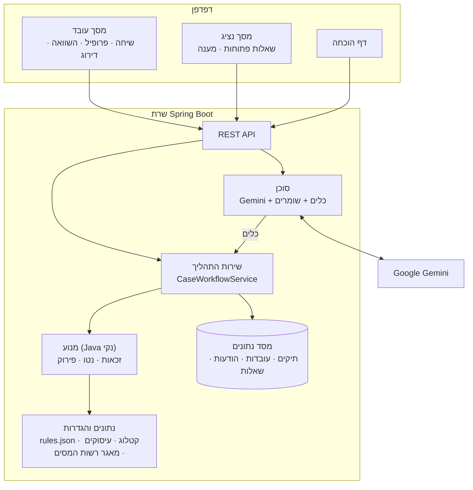
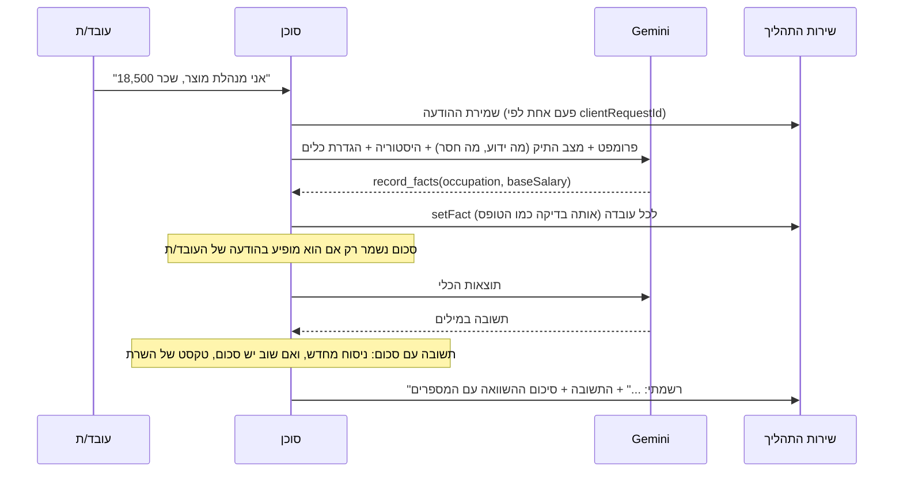
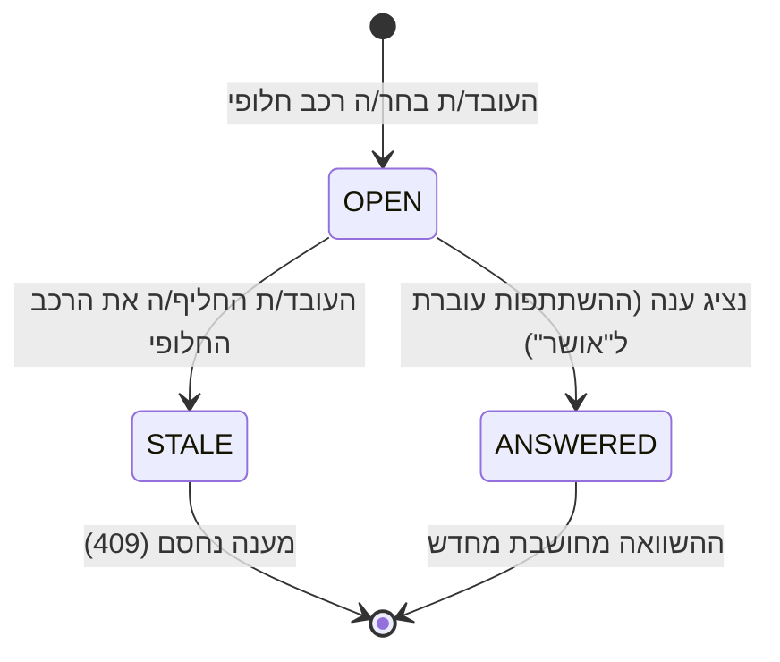

# ארכיטקטורה

## העיקרון: המודל מדבר, הקוד מחליט

שטראוס ביקשו שאותם נתונים ואותם כללים ייתנו תמיד אותה תוצאה. לכן כל מה שאפשר לבדוק (מספרים, זכאות, שליפה מהמאגר) נמצא בקוד דטרמיניסטי עם בדיקות. מודל השפה עושה רק מה שקוד לא יודע לעשות טוב: להבין עברית חופשית ולנהל שיחה.

## הרכיבים (לפי package)

| package | תפקיד | תלוי ב-Spring? |
|---|---|---|
| `engine` | חישוב הנטו, זכאות, גילום החזר החשמל, פירוק ה"למה", דירוג החלופות | לא. Java נקי, נבדק ביחידה |
| `data` | טעינת `rules.json`, הקטלוג, העיסוקים ומאגר רשות המסים, ובדיקתם זה מול זה | לא |
| `workflow` | המקום היחיד שמשנה תיק: עובדות, בחירת חלופה, שאלות לנציג, גרסאות | כן (JPA) |
| `agent` | לולאת השיחה מול Gemini, הכלים, הפרומפט, השומרים ומגבלת הקצב | כן |
| `api` | REST דק מעל `workflow` ו-`agent`, ושגיאות אחידות | כן |
| `proof` | הבדיקות החיות של `/proof.html` | כן |
| `config` | חיבור המנוע ל-Spring, ואבטחה | כן |
| `static/` | הממשק: HTML, CSS ו-JavaScript בלי ספריות ובלי build | |

## זרימה 1: הודעה בצ'אט

- הסוכן מריץ עד 6 צעדים בכל תור.
- התור של המודל נשמר בהיסטוריה כמו שהוא, כולל "חתימות המחשבה" ש-Gemini 3 דורש לקבל בחזרה.

## זרימה 2: שאלה לנציג

- **ההשתתפות היא הערכה עד שמגיעה תשובה.** כשנבחר רכב, ההשתתפות נקבעת לפי ברירת המחדל בקטלוג ומסומנת כך. ההשוואה מוצגת מיד, והשאלה לנציג נפתחת אוטומטית.
- **כל שאלה זוכרת את הנושא שלה** (איזה רכב). אם העובד/ת עבר/ה לרכב אחר, השאלה הישנה מתיישנת, כך שתשובה ישנה לא נוחתת על בחירה חדשה.

## החלטות תכנון

| החלטה | למה |
|---|---|
| **המנוע בלי Spring** | אפשר לבדוק אותו ביחידה, ואותו קלט נותן תמיד אותה תוצאה. שוחזרו בו 6 העובדים של שטראוס |
| **שירות תהליך אחד** | הצ'אט, הטופס והנציג עוברים כולם דרך אותן פקודות, עם אותה בדיקה ואותה שמירה |
| **"חסר" הוא היעדר שורה, לא 0** | לכל עובדה יש מצב (הוזן / הערכה / אושר) ומקור. 0 שהעובד/ת כתב/ה שונה מנתון חסר |
| **ההשוואה מחושבת בכל קריאה ולא נשמרת** | אין תוצאה ישנה שמגיעה אחרונה, ואין מצב "תקוע" אחרי הפעלה מחדש |
| **גרסה לכל תיק** | עדכון שנשלח על גרסה ישנה נדחה (409), ושני עדכונים במקביל לא דורסים זה את זה |
| **המודל לא כותב סכומים** | כל מספר שהעובד/ת רואה מגיע מהמנוע. גם ההסבר של שתי השורות נכתב בקוד |
| **פירוק "טלסקופי" של ההפרש** | מחליפים רכיב אחד בכל פעם, בסדר קבוע, ומודדים את השינוי בנטו בשקלים שלמים. סכום השורות שווה בדיוק להפרש המוצג |
| **הקבוצה נקבעת לפי טבלת העיסוקים** | עובד/ת לא יכול/ה "לשכנע" את הבוט שהוא/היא בקבוצה גבוהה יותר |
| **הקבצים נבדקים זה מול זה בעלייה** | קובץ פגום עוצר את השרת במקום לייצר מספרים שגויים. כל רכב בקטלוג חייב להופיע במאגר הרשמי באותו שווי |
| **המפתח המלא של רשות המסים** | שנת מס, שנת רישום, סוג רכב, קוד תוצר וקוד דגם. בלי סוג הרכב מקבלים רכב אחר: ATTO 3 מול TANG |
| **מיפוי ההנעה מקובץ הכללים** | הכותרת בקובץ של רשות המסים מתארת את הקודים בסדר שונה ממה שהנתונים בפועל |
| **השמעה מוקלטת של המודל** | גיבוי לדמו בלי רשת. מחליפה רק את קריאת המודל, ושאר המערכת רצה באמת. מוצהרת ב-API (`assistantMode`) |
| **ממשק בלי ספריות ובלי build** | עובד גם בלי אינטרנט, מתאים ל-CSP קשיח, ונגיש מכל דפדפן |

## בדיקות

| רמה | מה |
|---|---|
| מנוע | 6 עובדי הייחוס (נטו, מס, ביטוח לאומי, גילום, מסלול משפחתי, בסטייה של עד ₪1), זכאות, החזר חשמל של ₪250 בדיוק, פירוק שמסתכם להפרש |
| נתונים | 77,988 שורות, מפתח ייחודי, 20 מתוך 20 רכבי הקטלוג תואמים, מיפוי ההנעה |
| תהליך | חסר מול 0, שאלה לנציג, תשובה שמעדכנת, שאלה שהתיישנה, גרסה ישנה, תשובה כפולה, ניסיון לשנות קבוצה |
| סוכן | מודל מדומה שמנגן תורות מוכנים: סכום שהעובד/ת לא כתב/ה נדחה, סכום בתשובת המודל לא מגיע, הודעה שנשלחה פעמיים, מודל שנפל |
| אבטחה | ממשק הנציג דורש סיסמה, רישום מי ענה, CSP, שגיאות בלי פרטים פנימיים |
| חי | `/proof.html` מריץ 32 בדיקות מול השרת הפעיל. התרחישים רצים בטרנזקציה שמבוטלת בסוף |

## פרטים משניים שמוגדרים מראש
כדי שהשיחה תהיה קצרה (ארבע שאלות במקום עשר), בפתיחת תיק `CaseWorkflowService.create` שומר חמישה פרטים משניים כהנחות: עמלות 0, בונוס 0, פנסיה 6%, קרן השתלמות 2.5%, נקודות זיכוי 2.25. ההשתתפות ברכב היום מתמלאת בברירת המחדל של הקטלוג ברגע שנבחר הרכב. הם נשמרים עם סטטוס `DEFAULT` (מקור `CATALOG_DEFAULT`, הפניה `assumption`), לכן כל מסך מסמן אותם כהערכה, הם מופיעים ב-`comparison.estimates`, והם מוחלפים ל-`PROVIDED` ברגע שהעובד נותן מספר אמיתי. המנוע עצמו לא מכיר את המושג: הוא מקבל מספרים, והכללים והבדיקות מול מקרי הייחוס (±1 ש"ח) לא השתנו. זו החלטה מוצרית וניתנת להחלפה: משנים את `ASSUMED` ב-`CaseWorkflowService`.

## תשובה ישירה בלי מודל
לפני שהודעה מגיעה למודל, `ChoiceService.answerDirectly` בודק אם היא פשוט התשובה לשאלה הפתוחה ("24000" לשאלת השכר, "שני ילדים", "מנהלת מוצר", "Corolla Cross", "אין לי רכב"). הניתוח נעשה בקוד (`DirectAnswers`), עם אותן בדיקות טווח של הטופס, ורק תשובה טהורה נתפסת: משפט עם עוד פרטים ממשיך למודל כרגיל. לכן הצ'אט עובד גם כשהעוזר לא זמין, גם במצב השמעה, וחוסך קריאה למודל. הממשק משאיר את כפתור השליחה פעיל גם כשהעוזר לא זמין, והשרת מחליט.
